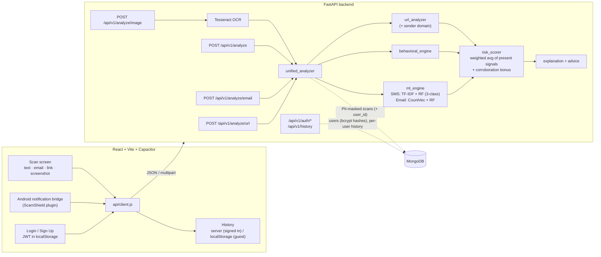
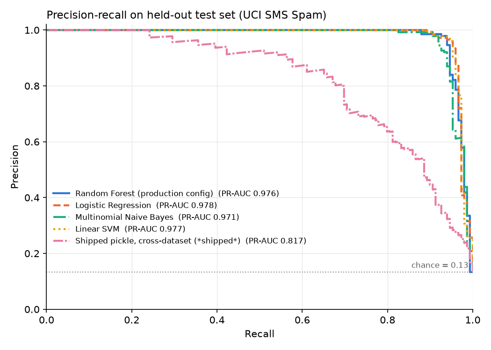

# Scam Shield

[](https://github.com/Hack4Innovation-2026/Scam-Shield--Hack4Innovation-26/actions/workflows/ci.yml)


Scam detection for the messages people actually get: SMS, WhatsApp/Telegram texts, emails, links and screenshots. A FastAPI backend combines three independent signals into one 0–100 risk score with a plain-language explanation and advice:

- **URL heuristics:** shorteners, suspicious TLDs, raw IPs, punycode, lure-word domains.
- **Behavioural patterns:** urgency, fear, reward and authority cues.
- **ML text classifiers:** TF-IDF + Random Forest for SMS, CountVectorizer + Random Forest for email.

A React (Vite + Capacitor) app is the client. It can be packaged for Android, where a native plugin feeds incoming notifications to the scanner.

Built for Hack4Innovation 2026.

**Documentation:** [Local setup](docs/SETUP.md) · [Android app](docs/ANDROID.md) · [Data storage & MongoDB](docs/DATABASE.md) · [Deployment](docs/DEPLOYMENT.md) · [Changelog](CHANGELOG.md)

---

## Architecture



**Request flow.** The client posts the raw input. The backend extracts URLs, scores behaviour and runs the matching ML model on the **unmasked** text. The models never saw masked placeholders, so masking first would hurt accuracy. The risk scorer then combines whichever signals apply: a link-free SMS has no URL score, and a bare URL has no text-model score. If MongoDB is configured, a **PII-masked** copy is stored.

| Score | Level | Action |
|---|---|---|
| 0–39 | safe | none |
| 40–69 | suspicious | alert user |
| 70–100 | scam | block sender; report link at ≥ 85 |

---

## Repository layout

```
backend/            FastAPI service
  main.py           app, CORS, lifespan (loads models, optional Mongo)
  app/routes/       analysis (text), email, url, image endpoints
  app/services/     url_analyzer, behavioral_engine, ml_engine, ocr, risk_scorer, ...
  app/schemas/      pydantic request/response models
  models/           pickled vectorizers + classifiers
  tests/            pytest suite (75 tests)
  Dockerfile
frontend/           React 19 + Vite + Capacitor app
  src/api/client.js backend client (the only place that talks to the API)
  src/screens/      UI screens
frontend/android/   Capacitor Android app + native background scanner (Java)
ml/                 training + evaluation scripts
  evaluate.py       model evaluation and comparison
  results/          metrics.md, metrics.json, pr_curves.png
docs/               setup, database and deployment guides
scripts/            Windows setup.ps1 / start.ps1
.github/workflows/  CI: tests, lint/build, Docker image
render.yaml         Render deployment blueprint
```

---

## Quick start

**Windows, two commands** (after installing Python 3.12+, Node 20+ and Git; full guide in [docs/SETUP.md](docs/SETUP.md)):
```powershell
powershell -ExecutionPolicy Bypass -File scripts\setup.ps1   # one-time setup
powershell -ExecutionPolicy Bypass -File scripts\start.ps1   # starts backend + frontend, opens the app
```

Or set up each part manually:

### Backend
```bash
cd backend
python -m venv .venv
.venv/Scripts/activate            # macOS/Linux: source .venv/bin/activate
pip install -r requirements-dev.txt
cp .env.example .env              # optional; every setting has a default
uvicorn main:app --reload
```
Open http://localhost:8000/docs for the interactive API docs.

Screenshot scanning needs the Tesseract binary. Without it the image endpoint returns `503`, and everything else works.
- Windows: `winget install UB-Mannheim.TesseractOCR`
- macOS: `brew install tesseract`
- Debian/Ubuntu: `apt install tesseract-ocr`

MongoDB is **optional**. It stores a PII-masked record of every analysis and powers `/api/v1/stats`. Leave `MONGO_URI` empty to run without it. Setup for Atlas, local install or Docker is in [docs/DATABASE.md](docs/DATABASE.md).

### Frontend
```bash
cd frontend
npm install
npm run dev                       # http://localhost:5173
```
In development, Vite proxies `/api` to `http://localhost:8000`, so no CORS setup is needed. For a production build or the Android app, set `VITE_API_URL`; the Android emulator reaches the host at `http://10.0.2.2:8000`.

**Accounts** need MongoDB. Sign-up and login are handled by the backend: passwords are hashed with bcrypt, and sessions use signed JWT tokens. Set `JWT_SECRET` in `backend/.env`; `scripts/setup.ps1` generates one. Without a database the app runs in guest mode, with history kept in the browser.

### Docker
```bash
docker build -t scam-shield-api backend
docker run -p 8000:8000 scam-shield-api
# or, with MongoDB persistence:
docker compose up --build
```

### Tests
```bash
cd backend && pytest
# include the live MongoDB tests:
TEST_MONGO_URI=mongodb://localhost:27017 pytest
```
CI runs the full suite, the frontend lint/build and a Docker build on every push and pull request.

### Deployment
The free setup is Vercel (frontend), Render (API, via `render.yaml`) and MongoDB Atlas. Step-by-step instructions are in [docs/DEPLOYMENT.md](docs/DEPLOYMENT.md).

---

## API

| Method | Path | Body |
|---|---|---|
| POST | `/api/v1/analyze` | `{"text": "...", "source": "sms" \| "whatsapp" \| "notifications" \| ...}` |
| POST | `/api/v1/analyze/email` | `{"subject": "...", "body": "...", "sender_email": "..."}` |
| POST | `/api/v1/analyze/url` | `{"url": "http://..."}` |
| POST | `/api/v1/analyze/image` | multipart `file` (PNG/JPEG, ≤ 5 MB) |
| GET | `/api/v1/stats?days=30` | aggregated scan statistics (requires MongoDB) |
| POST | `/api/v1/auth/register` | `{"name", "email", "password"}` → `{"token", "user"}` |
| POST | `/api/v1/auth/login` | `{"email", "password"}` → `{"token", "user"}` |
| GET | `/api/v1/auth/me` | the signed-in user (`Authorization: Bearer <token>`) |
| GET | `/api/v1/history` | the signed-in user's scans, newest first |

Analyze requests that carry a valid `Authorization: Bearer <token>` header are saved to that user's history. Without the header, the scan is anonymous.
| GET | `/` | health check (models and database status) |

```bash
curl -s localhost:8000/api/v1/analyze -H "Content-Type: application/json" \
  -d '{"text":"URGENT: Mumbai Cyber Police. Your Aadhar is linked to money laundering. Do not disconnect or face digital arrest.","source":"sms"}'
```
```json
{
  "risk_score": 97, "level": "scam", "scam_type": "digital_arrest", "intent": "fear / urgency",
  "confidence": "high", "action": "Block sender",
  "signals": {"url": null, "behavioral": 100.0, "ml": 75.84}, "ml_category": "digital_arrest",
  "reason": "This message uses pressure tactics (urgency/fear), which is a common phishing tactic.",
  "advice": "Verify with local authorities. Legitimate organizations do not demand immediate payment via phone/SMS.", "report": {"report_recommended": true, "...": "..."}
}
```

---

## Evaluation

`python ml/evaluate.py` (it downloads the dataset on first run). Full output is in [ml/results/metrics.md](ml/results/metrics.md).

**Setup.**
- **Data:** the public **UCI SMS Spam Collection**, 5,574 messages, 13.4 % spam. The original training CSV is not available.
- **Split:** stratified 80/20, plus 5-fold stratified CV on the training portion.
- **Leakage control:** each model is one sklearn `Pipeline(TfidfVectorizer → classifier)`, so TF-IDF is fit only on training folds.

**Held-out test set** (1,115 messages, decision threshold 0.5):

| Model | Precision | Recall | F1 | PR-AUC | FP | FN |
|---|---|---|---|---|---|---|
| Random Forest (production config) | **1.000** | 0.852 | 0.920 | 0.976 | 0 | 22 |
| Logistic Regression | 0.972 | 0.933 | 0.952 | 0.978 | 4 | 10 |
| Multinomial Naive Bayes | 0.978 | 0.906 | 0.941 | 0.971 | 3 | 14 |
| Linear SVM | 0.972 | **0.940** | **0.956** | 0.977 | 4 | 9 |
| *Shipped pickle (cross-dataset)* | 0.518 | 0.886 | 0.653 | 0.817 | 123 | 17 |

5-fold CV F1 (mean ± std):
- RF: 0.913 ± 0.018
- LR: 0.949 ± 0.011
- NB: 0.950 ± 0.007
- SVM: 0.953 ± 0.013



**Reading the results.**
- **Ranking ability is about equal.** All four architectures reach PR-AUC ≈ 0.97–0.98.
- **The difference is the default operating point.** The depth-limited RF is very conservative: zero false positives, but it misses 15 % of spam. The linear models trade 4 false positives for 12–13 more caught scams. For a scam detector, recall usually matters more, so **Linear SVM or Logistic Regression is the better choice** at the default threshold. Tuning the RF's threshold would close part of the gap.
- **The shipped pickle** comes from a different, unavailable 3-class dataset. Here it flags 12.7 % of legitimate messages, consistent with its poor calibration on benign text. This is why the API combines it with URL and behavioural signals instead of trusting it alone. Retraining on a documented dataset is the top roadmap item.

---

## Design decisions

- **Three independent signals, not one model.** Rules catch what a small text model misses (a `.xyz` lure domain, "digital arrest"), and the model catches phrasing no rule lists. When two signals agree, a corroboration bonus is added.
- **Missing signals are excluded, not zeroed.** A fixed 40 % URL weight capped link-free scams at 60, so they could never be flagged.
- **Analyse raw text, store masked text.** Masking before inference breaks URLs and feeds the models tokens they never saw.
- **Own authentication instead of a third-party SDK.** The same token works for the web app and the Android app. Passwords are bcrypt-hashed. Login errors don't reveal which emails are registered, and the user id comes only from the verified token, never from request data.
- **No fabricated results.** If the backend is down, the app says so, and the OCR endpoint returns `503` when Tesseract is missing.

## Known limitations & roadmap

- The SMS model is poorly calibrated on benign text; a legitimate bank OTP SMS scores ≈ 40 ("suspicious"). Next step: retrain a calibrated linear model on a documented dataset and swap it in.
- Email model: Enron-era training data, CountVectorizer + RF, no URL or sender features.
- The native Android `ScamShield` plugin (notification listener, toast) source is not in this repository; on the web, the bridge is skipped.
- No caller-ID / phone-number reputation source. The earlier simulated "Call" tab was removed.
- OCR is English-only (`tesseract-ocr` default language pack).
